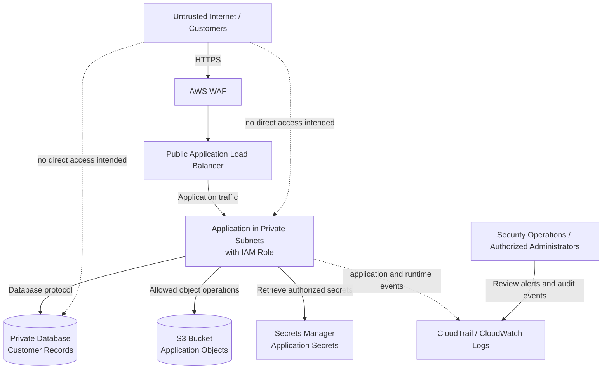

# Threat Model: Example AWS Web Application

> **Status:** Learning exercise — hypothetical architecture only  
> **Assessment type:** Design-level threat model  
> **Validation status:** No AWS resources deployed; no live configuration or controls verified  
> **Version:** 1.0

## 1. Purpose

This document demonstrates a basic threat-modeling exercise for a hypothetical customer-facing web application hosted on AWS. It identifies important assets, trust boundaries, plausible threats, proposed controls, and ways those controls could be validated.

This is not an assessment of a real AWS environment. Threats below are scenarios to investigate, not confirmed vulnerabilities.

## 2. Scope

**In scope**

- Public entry point and application traffic
- Application compute and its AWS identity
- Customer data stored in a database and object storage
- Application secrets
- AWS account permissions and audit logging
- Availability of the public application

**Out of scope**

- Detailed application-code review
- A real penetration test
- A live AWS configuration assessment
- Vendor and physical security assessments

## 3. Assumptions

1. Customers access the application over HTTPS from the public internet.
2. An AWS WAF and public Application Load Balancer (ALB) are proposed as the entry point.
3. Application compute runs in private subnets and accesses a private database.
4. The application uses an IAM role rather than long-lived AWS access keys.
5. The application may read or write selected S3 objects.
6. CloudTrail records account activity; CloudWatch is used for selected logs, metrics, and alarms.
7. A separate security/logging account may be introduced in a future design, but is not assumed to exist in this example.
8. No deployment or live validation is performed for this exercise.

These assumptions would need confirmation in a real review.

## 4. Architecture and trust boundaries

### Trust boundaries

- **TB-1: Internet to public entry point.** Requests originate from untrusted clients and must be filtered and handled safely.
- **TB-2: Entry point to application.** Only intended traffic should reach the application; the application must not be directly exposed unintentionally.
- **TB-3: Application to data stores.** The application should access only the data and operations it needs.
- **TB-4: Workload identity to AWS APIs.** The application role must not grant unnecessary access to other resources.
- **TB-5: Workload to audit/monitoring services.** Logs must be sufficient for investigation and protected against unauthorized alteration or deletion.
- **TB-6: Administrator to security configuration.** Administrative changes should be authenticated, authorized, and auditable.

## 5. Assets and security objectives

| Asset | Security objective | Example impact if compromised |
|---|---|---|
| Customer records | Confidentiality and integrity | Data disclosure or unauthorized changes |
| Customer accounts and sessions | Authentication and authorization | Account takeover or access to another customer's data |
| Application availability | Availability | Service interruption |
| IAM roles and policies | Least privilege and integrity | Access to resources beyond the application's needs |
| Application secrets | Confidentiality and controlled access | Compromise of databases or dependent services |
| Audit logs | Integrity, availability, and useful coverage | Reduced ability to detect or investigate incidents |
| Deployment/security configuration | Integrity and traceability | A change weakens controls or exposes resources |

## 6. Threat register

Ratings are preliminary and illustrative. In a real assessment, likelihood and impact must be justified using the actual architecture, exposure, existing controls, business impact, and threat information.

| ID | Threat scenario | STRIDE | Likelihood | Impact | Initial priority | Proposed controls | Validation / evidence |
|---|---|---|---|---|---|---|---|
| T-01 | A compromised application abuses an overly broad IAM role to read or modify unrelated S3 objects. | Elevation of Privilege; Information Disclosure; Tampering | Medium | High | High | Grant only required S3 actions on specific resources; avoid broad wildcards where practical; review role trust policy and permissions. | Inspect policy documents; identify required actions/resources; use policy analysis and positive/negative authorization tests in an approved test environment. |
| T-02 | The database is exposed to the internet or accepts connections from more sources than required. | Information Disclosure; Tampering | Low–Medium | Critical | High | Keep the database private; restrict security-group ingress to the application security group and required port; require appropriate authentication and encryption in transit. | Review subnet routes and security-group rules; inspect database exposure settings; confirm only intended sources can connect. No live checks performed in this exercise. |
| T-03 | An attacker obtains an application secret from source code, logs, or an overly permissive secret store. | Spoofing; Information Disclosure | Medium | High | High | Store secrets in an appropriate secrets manager; restrict retrieval permissions; avoid logging secret values; define rotation and incident-response procedures. | Search sample repositories/configuration for secret patterns; review access policy; test that unauthorized identities are denied; inspect sample logs for accidental secret disclosure. |
| T-04 | Security-relevant account changes are not logged or logs can be altered/deleted by an overly privileged identity. | Repudiation; Tampering | Medium | High | High | Enable appropriate CloudTrail coverage; centralize and protect logs where feasible; restrict log access and deletion; monitor changes to logging configuration. | Review intended event coverage, destinations, access controls, retention, and alerting; create a test event in an approved environment and confirm evidence is available. |
| T-05 | Excessive requests or abusive traffic exhaust application capacity and disrupt service. | Denial of Service | Medium–High | Medium–High | High | Use suitable WAF managed protections and rate-based rules; set sensible resource limits and scaling behavior; define alarms and response procedures. WAF alone is not a complete DDoS strategy. | Review rule design and service limits; define a safe, approved load-test plan; confirm metrics and alarms using test events or synthetic data. Do not perform an unapproved live traffic test. |
| T-06 | A customer changes an object identifier or request parameter and accesses another customer's records because server-side authorization is missing. | Spoofing; Information Disclosure; Tampering | Medium | High | High | Enforce authorization server-side for every object/action; derive identity from a trusted authentication context; do not rely on hidden UI fields or unpredictable IDs as authorization. | Write tests for owner versus non-owner access, including read and update operations; review authorization logic. This requires application-level testing. |
| T-07 | An administrator or compromised identity weakens a security control without timely detection. | Tampering; Elevation of Privilege; Repudiation | Low–Medium | High | High | Apply least privilege and MFA through the identity platform; restrict high-impact permissions; require review for sensitive changes; alert on changes to logging, IAM, and network controls. | Review role assignments and change workflow; define relevant CloudTrail event patterns; test alerts with synthetic events or an approved sandbox. |

## 7. Example threat analysis: T-01 excessive IAM permissions

**Scenario:** The application is compromised through an application vulnerability. The attacker inherits the application's AWS permissions and uses them to access S3 resources unrelated to the application.

**Why it matters:** A compromise that should have been limited to one workload could affect other data if the role has broad permissions.

**Preventive controls:**

- Use an application-specific IAM role.
- Limit actions to those the application requires.
- Scope resource permissions to the required bucket and object paths where supported.
- Review the role's trust policy and avoid unnecessary ability to assume other roles.
- Separate duties and identities between workloads where practical.

**Detective controls:**

- Enable and retain relevant audit events, including S3 data events where the required visibility justifies the configuration and cost.
- Alert on unusual access patterns or access to sensitive resources outside the application's normal behavior.
- Ensure responders can identify the role session and correlate events.

**Validation plan:**

1. Document the application's required S3 operations.
2. Compare those requirements with the proposed policy.
3. Flag actions or resources that are not necessary.
4. Create positive tests for required operations and negative tests for prohibited operations.
5. In an approved sandbox, execute the tests and retain policy and test-result evidence.
6. Confirm the relevant events are logged if logging coverage is part of the control objective.

**Current result:** Not tested. This is a proposed validation plan, not evidence that the role is secure or insecure.

## 8. Risk prioritization and treatment

The initial priorities above are only a starting point. Prioritize work by considering exploitability, exposure, business impact, affected data, existing safeguards, and how broadly a compromise could spread.

Suggested order for design review:

1. Confirm that sensitive data stores are not unintentionally public.
2. Restrict workload IAM permissions and secret access.
3. Ensure authorization is enforced for customer data at the application layer.
4. Ensure audit logging is enabled, protected, and actionable.
5. Define availability protections and an approved validation approach.
6. Review administrative access and detection of security-configuration changes.

If a risk is accepted rather than fixed, record who approved it, why it is acceptable, any compensating controls, and when it must be reviewed again.

## 9. Validation plan and evidence

Because this is a local learning exercise, no AWS controls have been verified. A future validation checklist could include:

- [ ] Review IAM role trust policies and permissions.
- [ ] Check proposed security groups and subnet routes for unintended exposure.
- [ ] Review secret storage, access policy, and rotation approach.
- [ ] Review CloudTrail coverage and log destination protections.
- [ ] Define sample CloudTrail events for administrative changes and unexpected role use.
- [ ] Define application authorization tests for cross-customer access.
- [ ] Define a safe, approved test plan for WAF behavior, alarms, and availability controls.
- [ ] Record test method, expected result, actual result, evidence, and any limitations.

Do not claim a control works merely because it appears in a diagram or design document.

## 10. Limitations

- The architecture is hypothetical.
- No AWS resources, IAM policies, security groups, or logging destinations were inspected.
- No application code was reviewed.
- No scanner, penetration test, load test, or live detection test was run.
- Risk ratings are illustrative and may change after the actual architecture and controls are reviewed.
- Service availability, configuration options, and costs must be checked against current AWS documentation before implementation.

## 11. Follow-up actions

1. Learn IAM policy evaluation and least privilege, then revisit T-01.
2. Learn CloudTrail event structure and logging coverage, then define example events for T-04 and T-07.
3. Create synthetic audit events and write a small investigation report.
4. Later in the learning plan, adapt this exercise to a synthetic multi-account architecture inspired by AWS Landing Zone Accelerator (LZA).

## 12. References

- AWS Security Services Best Practices: https://aws.github.io/aws-security-services-best-practices/
- Microsoft Threat Modeling Security Fundamentals: https://learn.microsoft.com/en-us/training/paths/tm-threat-modeling-fundamentals/

---

**Learning note:** The purpose of this document is to demonstrate a repeatable process: define scope, identify assets and trust boundaries, describe threat scenarios, prioritize risks, propose controls, and state how each control would be validated. It is not a security certification or a substitute for reviewing a real deployment.
